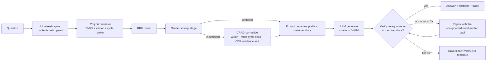

# The billing agent (Layers 1 to 4)

> **Two AI paths, chosen on purpose:**
> - **Bill explanation:** one structured LLM call over computed facts, in `agent/explain_llm.py`. The inputs are known up front, so a tool loop would add latency and cost without adding relevance. The output is JSON: summary, drivers, top usage and a tip. Each item cites sources, and every number is checked against the sources that item cites, with up to 2 repairs. Results are cached for 30 days, keyed by the sources, language, model and the **prompt text actually served** (a new Langfuse version never reuses old explanations). Driver impacts are before VAT and totals include VAT, and the prompt makes the model say which. The model's JSON is normalised to the shape the page renders.
> - **Assistant (chat):** a **multi-step, multi-tool ReAct agent behind a broker**, streamed over SSE (`agent/loop.py`, `agent/broker.py`, `agent/tools.py`). It follows the perpetuum design:
>   - **The broker is the only executor.** It checks the allow-list, validates arguments against a JSON schema, runs tools scoped to the caller, caps each result's size and logs every decision.
>   - **Facts first:** every turn starts with a fresh account snapshot read through the broker before the model writes anything: `get_current_usage` (pro-rated exactly as the app shows it: plan data, add-ons, remaining / over by), `list_bills` (dues), `get_orders`, `get_plans_and_addons` (country catalog, largest plan, how changes take effect, this month's total if switched today). Earlier chat turns are context only.
>   - **Tools:** `list_bills` (6 bills by default), `get_bill`, `compare_bills`, `get_current_usage`, `search_knowledge` (L2 hybrid search with RRF and the CRAG grader), `get_cdr_evidence`, `get_payments`, `get_alerts`, `get_orders`, `get_plans_and_addons`, `simulate_usage`; propose tier: `propose_addon` (returns its real effect this month), `propose_plan_change`, `propose_payment`. The number check is locale-aware (`9.99` never matches `999`; `41,59` = `41.59`). Bill tools return `outstanding`, `paid_so_far`, `payment_status` (overdue / not yet due / paid), `days_overdue` or `days_until_due`, and dates in words. Each result is capped at 8,000 chars (`RESULT_CHARS`).
>   - **Limits:** 6 turns and 10 tool calls; tools are withheld on the last turn so the model must answer.
>   - **Events:** `step`, `step_done`, `proposal`, `token`, `done`. `token` carries only the final, checked answer: the model's draft is never streamed.
>   - **Verification:** every figure in the answer must appear in a tool result of this turn; failures are repaired silently through the tool loop. `[S#]` citations are then attached by code (`attach_sources`). It never falls back to a template.
>   - **Approval cards** (`proposal`) are held until the final answer and sent once with it, so they always match its words. They are stored with the chat message (`{sources, cards}`) and restored when a chat is reopened. The open conversation is in the URL (`?c=<id>`).
>
> The spine-first retrieval pipeline described below is what the `search_knowledge` tool uses.

The assistant ("Ask about your bill") and the bill explanation run through one agent. It never answers from
the model's own knowledge: every statement is grounded in **documents built from the system's own records**,
every number is verified against the documents it cites, and every run leaves a full trace.

## L1: durable context spine
- **Store:** table `context_docs` in Autonomous DB 23ai, with a native `VECTOR(384, FLOAT32)` column and a portable JSON copy.
- **What's in it.** Small, citable documents, each with a `source_ref` pointing at the system of record:
  - **Per subscriber:**
    - plan profile (CRM)
    - every issued bill (`adb:bills:<id>`)
    - every bill-to-bill change (rating engine/explainer)
    - **live current-cycle usage from the CDR totals in Valkey**, versioned by stream offset (`valkey:u:{pN}::<cycle>@offsetN`), priced through `unbilled()` like the app (tariff changes, mid-month join). The text has no clock time, so its hash changes only when the facts do.
    - alerts and payments
  - **Shared:** plan sheets, roaming zones, rounding, VAT, add-ons, billing-cycle and late-CDR policy, all generated from the product catalogue.
- **Privacy:** no names, phone numbers or emails are written into documents. Documents use customer words (no status codes such as ISSUED/CREATED, dates in words).
- **When it updates:**
  - **Event-driven:** the worker re-embeds a subscriber as soon as an alert fires.
  - **Sweep every 60 s:** picks up new CDR totals, issued bills and payments.
  - **Before every answer:** a refresh that costs one DB read when nothing changed.
- **Cost of updates:** content-hash upserts mean only changed documents are re-embedded. Documents that are no longer generated (last month's live usage, removed bills or payments) are deleted, so they stop being searchable. Two writers inserting the same new document retry as an update.
- **Embeddings:** `all-MiniLM-L6-v2` running **locally** (fastembed/ONNX, the Python equivalent of Xenova MiniLM), baked into the image. No embedding API, no per-token cost, and the data stays in the cluster. DeepSeek offers no embeddings endpoint anyway.

## L2: retrieval and CRAG
- **Lexical:** BM25 over the customer's and shared documents.
- **Semantic:** cosine similarity with the query embedding, computed in **Oracle 23ai `VECTOR_DISTANCE(…, COSINE)`**.
- **Metadata ranker:** documents about the billing cycle the question refers to (from an explicit cycle or a month name in the question; whole words only, and "may" only in a month context).
- **Reciprocal Rank Fusion** (k = 60) combines the three rankings. The trace shows each document's BM25, vector and RRF scores and its ranks.
- **Grader:** a cheap, short LLM call (JSON mode) marks each document relevant or not and says whether the context is sufficient.
- **Corrective RAG.** When the grade is insufficient or fewer than 2 documents are relevant:
  1. **Widen** retrieval (top 14).
  2. **Fetch every document of the target cycle** by metadata.
  3. If the question asks for proof (CDR, records, verify…), call the **CDR-evidence tool**. It re-reads the subscriber's raw CDRs from the Object Storage archive and reconciles them with the running totals.
- **If the grader fails or its budget is exhausted,** the agent falls back to an RRF threshold and records the degradation in the trace.

## Generation and verification (no templates)
- **Prompt layout:** the system prompt holds the rules plus all shared knowledge as `[G1..Gn]`, in a fixed order. The user message holds the customer documents as `[D1..Dn]` plus the question and the reply language.
- **Citations:** every factual sentence must cite `[D#]`/`[G#]`.
- **Verifier, enforced in code:**
  - citations must exist
  - an answer with no citations is rejected
  - **every number in the answer must appear in the documents it cites**
- **Repair loop:** on failure the model gets the exact problems ("number 999 is not in the cited documents") and rewrites, up to 2 times. Status: `VERIFIED`, or `REPAIRED` if a rewrite was needed.
  - Repairs run **with the tools**, so the model can look a fact up instead of dropping it. A real failure on prod showed why: the model answered a due date from an earlier chat answer without calling a tool. The tool-less repair then invented a citation, and the next one replied "I don't have the bill details", which replaced a correct answer.
  - A rewrite that verifies only because it dropped every fact is rejected.
  - Earlier chat answers are context, not sources. The prompt says so, and only answers that passed verification are fed back as history.
  - Day counts (`days_overdue`, `days_until_due`) come from the tools, so the model never does date maths, which the verifier would rightly reject.
- **Citations are attached by code, not demanded from the model.** Every figure must appear in a tool result of this turn, and `attach_sources` adds the `[S#]` markers afterwards. Before this, 7 of 8 answers in one conversation were rewritten only because the model left out a marker, and the customer saw the answer change after the "double-check".
- **Only the final answer is shown:** tools run (their steps are shown), the answer is drafted, checked and silently repaired, and only then is the final answer written out in chunks (`deliver`). Nothing on screen is replaced afterwards; there is no "double-checking" notice and no reset/replace event (`STREAM_DRAFTS = False`).
- **Payment card by code:** payment is prepared from the final answer (after the checks). If it sends the customer to the checkout and no payment was prepared, code calls `propose_payment`, with no extra model round. An answer that points to a checkout or approval "below" that was never prepared is a verification problem, and the repair prepares it.
- **Repairs** use the agent stage's budget (the small `repair` cap would turn answers into budget messages) and fetch only what the question needs.
- **Tone:** the prompt asks for a warm, plain-language care agent, with no status codes, field names or internal terms, and no invented policy (fees, restrictions). Payments tool output is customer-level: paid, declined or awaiting the bank; abandoned checkouts are left out.
- **Prompts reach prod:** the prompt is served from Langfuse ("production" label). A post-upgrade Helm hook (`prompt-seed`) publishes the repo prompt as a new version whenever its text changed. Before this, prod kept serving an old version and prompt changes in code never applied.
- **If it still can't be verified,** the answer says so (`UNVERIFIED`). It never substitutes canned text. The deterministic breakdown and CDR evidence on the page are always exact.

## L3: prompt caching
- **Implicit (provider):** the system prompt is a stable prefix (rules plus shared knowledge, fixed order) and only the suffix varies, so DeepSeek's automatic prefix cache bills repeated tokens at the cache-hit rate. `prompt_cache_hit_tokens` and `prompt_cache_miss_tokens` are recorded for every call and shown in the trace.
- **Explicit (ours):** an answer cache keyed by `sha256(question, language, provider, model, prompt version, (doc id, content hash) of the exact context)`, kept for 24 h.
  - **New CDRs** change the live-usage document's hash, so the next question about this month is answered again.
  - **An issued bill never changes,** so its explanation is served from cache.

## L4: guardrails and cost control
| Guardrail | Value | Where |
|---|---|---|
| Item-level budget | about 600 tokens per document (2,400 chars) | `agent.py` `DOC_CHARS` |
| Context budget | about 3k tokens of customer documents | `CONTEXT_CHARS` |
| Tool result size | 8,000 chars per result | `broker.py` `RESULT_CHARS` |
| Stage `max_tokens` | grade 300 · generate 450 · repair 450 | `llm.py` `STAGES` |
| **Stage-level daily spend caps (USD)** | grade $0.50 · generate $2.00 · repair $1.00 | Valkey `spend:<stage>:<day>`, cost from the provider's usage block |
| Cheap-stage routing | grader runs with temperature 0, JSON mode and a small `max_tokens`; skipped when capped | `llm.py`, `agent._grade` |
| Per-customer abuse guard | 200 requests/day | `assistant.py` |
| Data minimisation | no identifiers in documents or prompts (tested) | `spine.py`, `test_agent.py` |

**When a cap is hit:** the stage is skipped and the agent degrades. With no grader it uses the RRF threshold; with no generation budget the status is `BUDGET` and the breakdown is shown. It never overspends.

## Regression testing and quality over time

An agent isn't deterministic, so no single output is tested; layers are:

| Layer | Catches | Runs |
|---|---|---|
| Unit tests with a scripted fake LLM | loop, tools, citations, approval cards, number checker, snapshot | every PR |
| Runtime verifier | a number not backed by a tool result (repaired once, else UNVERIFIED) | every answer |
| Golden set (`run-evals`, 17 questions) | grounding, required facts, tool use, **policy correctness (judge)** | every deploy (gate) |
| Smoke + browser e2e | the deployed journey | every deploy |
| Sampled production judge | policy breaks in real conversations | 25% of answers, in the background |

**Policy judge** (`agent/judge.py`). Grounded is not the same as right: "a plan with more data from next month"
is grounded in the catalog and still wrong (a tariff change applies today). The judge scores answers against nine
explicit rules (R1 tariff change today, R2 add-on billing, R3 proposed is not done, R4 overdue blocks orders,
R5 beyond-allowance rule of the plan, R6 only real products and prices, R7 honest add-on effect, R8 no internals /
injection, R9 answer first), temperature 0, JSON with rule ids. Offline it votes (majority of 3 calls).

**Calibrated against human labels.** `evaldata/judge_labels.jsonl` holds labelled answers (both classes, every rule
with a negative example, 4 of them real production answers). `run-evals --calibrate` measures agreement (accuracy,
Cohen's kappa, recall of real breaks); the judge gates a deploy only while kappa >= 0.6, otherwise its scores are
reported but ignored. The model behind `judge-llm` was picked this way (23 Nov): deepseek-chat kappa 0.93 on three
runs, mistral-small 0.60-0.86 with rate-limit errors. Same family as the answering model, so self-preference is a
known risk that the labels keep measuring. Known blind spot: add-on arithmetic (R7). The labels are seed labels
written from the 22/23 Nov incidents and need a human review; growing them from reviewed production answers is
the next step.

**Gate** (deploy pipeline, last step): `kubectl exec deploy/core-api -- run-evals --gate --calibrate`. Thresholds:
grounded >= 90%, required facts >= 80%, tool use >= 85%, judge pass >= 80% (lower on purpose: about one judge
mistake per run on real answers; 1 case = 6 points on 17). Eval personas are lines that can't order, every eval chat
is deleted, and any proposal is removed, so a run never changes an account.

**Trends** (System page, "Assistant quality"): per day verified / repaired rate, p50 / p95 latency, cost per
answer and judge pass rate (sampled), last 7 days vs the 7 before, rules broken, the last golden runs and the
judge's calibration. Data: `agent_traces`, `answer_judgements`, `eval_runs`.

## When does it reason?
- **On a question** (assistant) or **when a bill page is opened** (explanation), always on the **latest spine**: refreshed first, and kept current by the event-driven builder as CDRs, bills, alerts and payments arrive.
- **Closed bills:** explained once, then cached until anything they depend on changes.
- **The current month:** re-reasoned whenever new CDR totals change the live-usage document.

## Cost model
| Item | Cost |
|---|---|
| Embeddings | $0 (local MiniLM, a few ms per document on CPU) |
| Vector search | $0 (Oracle 23ai in Always Free ADB) |
| LLM per explanation | 1 grader call plus 1 generation, about 1.5–3k input tokens (mostly a cache-hit prefix) and about 100–300 output tokens. The exact USD figure is shown per answer in the trace. Prices are config in `llm.py` (`PRICES`). |
| Repeat views | $0 (answer cache) |
| Infra | One E5.Flex node (about $1.5/day). Everything else is Always Free. |

## Where to look
- **Code:** `services/core-api/src/core_api/agent/`, with files `spine.py`, `embed.py`, `retrieve.py`, `llm.py`, `agent.py` and `factory.py`.
- **API:**
  - `POST /v1/me/assistant/ask`
  - `GET /v1/me/assistant/traces`
  - the explanation inside `GET /v1/me/bills/{cycle}/explanation`
- **UI:** the Assistant page; under every explanation, "Sources, evidence and how this answer was made".
- **Tests:** `services/core-api/tests/test_agent.py`:
  - the spine is built from records and only changed documents are re-embedded
  - hybrid retrieval puts the right cycle first
  - verified answer with citations, cost and trace
  - repair loop (no template)
  - honest "unverified" result
  - answer cache plus stage spend cap
