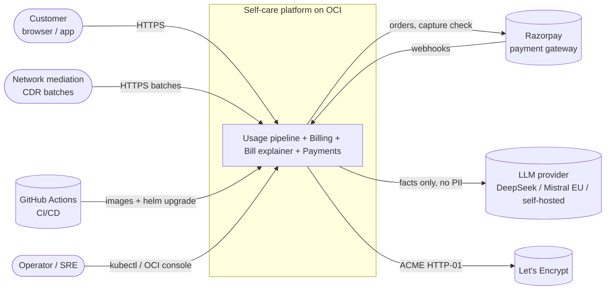
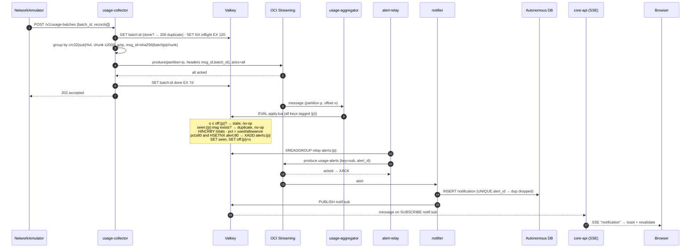
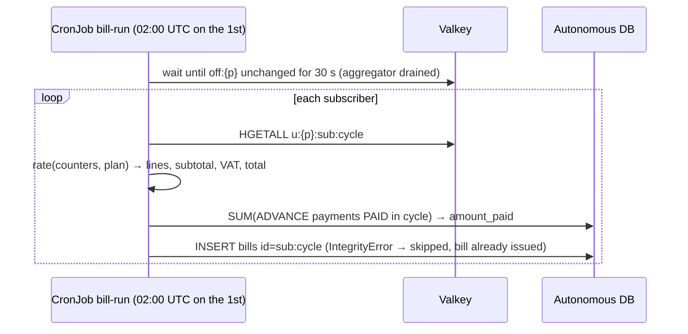
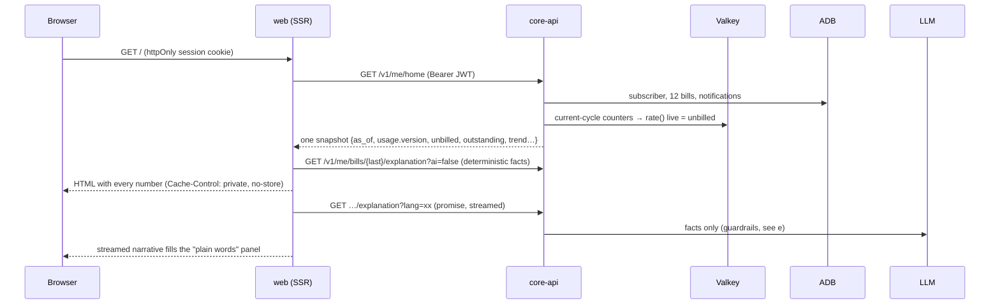
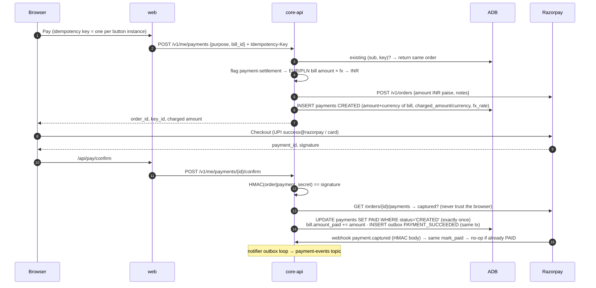

# High-Level Design: Telecom Self-Care (Usage & Bill Explainer)

> Companion docs: [LLD.md](LLD.md) (APIs, schemas, algorithms) · [OPERATIONS.md](OPERATIONS.md) (how to look inside DB, Valkey, streams) · [LOADTEST.md](LOADTEST.md)

## 1. Context and goals

A multi-country mobile operator (DT-like: ~50M subscribers in 10 European countries) wants a self-care experience where a customer can:

- see their **bill trend** over 12 months, view and **download** any bill
- see the **unbilled amount** for the running month and **pay** (bill or advance), through a real payment gateway
- understand **why the bill changed** and the **top usage drivers**, also in plain language (AI)
- **upload or select usage** to see what it would cost
- get **real-time data alerts** (50/80/100% of allowance), exactly once

The bill is the product. Behind it sits a **real-time usage pipeline** that turns network usage records (CDRs) into running totals per subscriber and billing cycle.

### Non-functional requirements and capacity math

| Requirement | Target | Derivation / consequence |
|---|---|---|
| Subscribers | 50M across 10 countries | Country is a field on every record and config; one deployment per region |
| Usage records | ~5B/day | 50M × ~100 sessions/records per day |
| Throughput | **60k/s average, 150k/s evening peak** | 5B / 86,400 ≈ 58k/s; peak factor ~2.5 |
| Raw volume | ~1 TB/day | 5B × ~200 B; raw kept in cheap Object Storage (audit), aggregates in Valkey |
| Wire volume at peak | ~30 MB/s raw → **~6 MB/s gzip** | gzip on JSONL batches gives ~5× (measured ≥4× in tests) |
| OCI Streaming partitions | 1 MB/s write per partition | 6 MB/s → 8 partitions at 75%; **provision 12–16** (fixed at stream creation) |
| Alert latency | p95 < 1 min | Streaming path, not batch |
| Correctness | No double count, **exactly one alert per level per cycle** | Idempotent consumer (see §6) |
| App reads | ~10M app users/day, ~2,500 req/s peak | Read running totals (O(1)), never SUM raw rows |
| Data residency | GDPR: EU customer data stays in the EU | Per-region deployment; LLM provider per country by flag |
| Cost (case study) | Near zero | Always Free OCI services; one ~$1.5/day worker node |

## 2. System context (C4 level 1)



## 3. Containers (C4 level 2)

> The service split, LLM gateway, Temporal workflows, order/bss event streams, circuit breakers and
> bill-day preparation are described in **[PLATFORM.md](PLATFORM.md)**, which supersedes the
> "core-api (modular monolith)" box below. Payments, the assistant and the order adapter now run as
> separate services.

```mermaid
flowchart TB
  subgraph Edge
    traefik[Traefik ingress<br/>TLS via cert-manager + Let's Encrypt<br/>Always Free flexible LB 10 Mbps]
  end
  subgraph Customer side
    web[web<br/>React Router SSR, Express<br/>trust proxy, httpOnly session]
    core[core-api: modular monolith<br/>auth · home BFF · bills · PDF · payments<br/>insights/explainer · AI narrator · simulator · admin · SSE]
    notifier[notifier worker<br/>alerts → notifications + push<br/>DB outbox → payment-events]
  end
  subgraph Usage pipeline
    emu[network-emulator<br/>backfill · live · load]
    coll[usage-collector<br/>validate · batch idempotency<br/>partition · gzip · publish]
    agg[usage-aggregator ×2<br/>atomic Lua apply · exactly-once]
    arch[raw-archiver]
    relay[alert-relay<br/>outbox → topic]
  end
  subgraph OCI managed
    stream[(OCI Streaming, Kafka API<br/>usage-events 4p · usage-alerts 1p · payment-events 1p)]
    adb[(Autonomous DB 23ai<br/>Always Free)]
    os[(Object Storage<br/>dt-selfcare-usage-raw)]
    vault[(OCI Vault)]
  end
  valkey[(Valkey StatefulSet<br/>AOF on block volume)]
  flagd[flagd<br/>OpenFeature flags]
  eso[External Secrets Operator]
  rzp[(Razorpay)]
  llm[(DeepSeek / Mistral / vLLM)]

  traefik -->|/| web
  traefik -->|/v1/webhooks/razorpay| core
  web --> core
  emu -->|POST /v1/usage-batches| coll
  coll --> stream
  stream -->|group usage-aggregator| agg
  stream -->|group raw-archiver| arch --> os
  agg <--> valkey
  valkey -->|alerts:{pN} streams| relay --> stream
  stream -->|group notifier usage-alerts| notifier
  notifier --> adb
  notifier -->|PUBLISH notif:sub| valkey
  core -->|SUBSCRIBE notif:sub, SSE| valkey
  core --> adb
  core -->|read counters, rate live| valkey
  coll -->|batch:id idempotency| valkey
  core --> rzp
  core --> llm
  core & agg & coll & notifier --> flagd
  eso --> vault
  eso -->|k8s Secrets| core & web & agg & coll & notifier
```

**Why it's shaped this way:** the hot path (collector, aggregator) scales with event volume and is split out. The customer domains scale with requests and live in one deployable (`core-api`) with strict module boundaries, so any module can be extracted later without a rewrite.

## 4. OCI deployment

```mermaid
flowchart TB
  subgraph TEN[Tenancy · home region ap-mumbai-1]
    subgraph CPT[Compartment dt-selfcare · isolated from other workloads]
      subgraph VCN[VCN 10.20.0.0/16 · dtself]
        api[Subnet api 10.20.0.0/28 · public<br/>OKE API endpoint :6443]
        lb[Subnet lb 10.20.1.0/24 · public<br/>Flexible LB 10 Mbps · 80/443]
        wk[Subnet workers 10.20.10.0/24 · private<br/>node pool dt-selfcare-a1<br/>1 × VM.Standard.E5.Flex 1 OCPU/16 GB]
      end
      igw[Internet GW]; nat[NAT GW]; sgw[Service GW<br/>All Oracle Services]
      oke[OKE BASIC_CLUSTER dt-selfcare-oke<br/>k8s v1.37.1 · flannel]
      adb[(ADB dtselfcare · 23ai · Always Free<br/>TLS, ACL = VCN only)]
      sp[(Stream pool dt-selfcare-pool<br/>usage-events 4p · usage-alerts · payment-events<br/>retention 48 h)]
      b1[(Bucket dt-selfcare-usage-raw<br/>archive @30d · delete @400d)]
      b2[(Bucket dt-selfcare-tfstate<br/>versioned)]
      v[(Vault dt-selfcare-vault<br/>software key · platform + 3rd-party secrets)]
      ocir[(OCIR repos dt-selfcare/*<br/>private)]
    end
    iam[IAM: user dt-selfcare-svc (stream push/pull, OCIR read)<br/>user dt-selfcare-ci (OCIR push, use clusters)<br/>dynamic group dt-selfcare-nodes (read secrets, write raw bucket)<br/>policies dt-selfcare-workloads / -ocir / -objectstorage-lifecycle]
  end
  api --- igw; lb --- igw; wk --- nat; wk --- sgw
  sgw --> adb & sp & b1 & v & ocir
```

All of it is defined in Terraform (`deploy/terraform`), with remote state in `dt-selfcare-tfstate`. The A1 (ARM, Always Free) shape was out of host capacity in Mumbai on the build day. `node_shape` is a variable, and switching back to A1 changes the image architecture automatically.

## 5. Key flows

### (a) Usage record → running total → 80% alert, exactly once → push to the open app



### (b) Bill run at cycle close


Bills are immutable. Re-running the job is safe. Late records stay in the cycle counters and become an adjustment through reconciliation, never a mutation of an issued invoice.

### (c) Home page (server-rendered snapshot + streamed AI narrative)



### (d) Payment



### (e) AI explanation with guardrails

```mermaid
flowchart LR
  ex[explainer.explain<br/>deterministic facts] --> f{flag ai-explanations<br/>and provider configured?}
  f -- no --> T[template = facts joined]
  f -- yes --> c{cache hit?<br/>sha256 facts·lang·provider·model}
  c -- yes --> out[cached text]
  c -- no --> rl{daily budget<br/>rl:ai:sub ≤ 20}
  rl -- over --> T
  rl -- ok --> br{circuit breaker<br/>per provider open?}
  br -- open --> T
  br -- closed --> call[LLM chat completion<br/>system prompt + facts only, temp 0.2, 12 s timeout]
  call -- error/timeout --> T
  call --> g{every number in answer<br/>∈ numbers in facts?}
  g -- no --> T
  g -- yes --> save[INSERT explanations cache] --> out
```

### (f) Usage upload / scenario simulation
The customer uploads CSV/JSON (≤1 MB, ≤10,000 rows, validated units and zones) or picks a scenario. `core-api` converts it to counters, prices it with the **same** `rate()` as the current cycle, explains it against the latest real bill, and narrates it with the same guardrails. **Nothing is written to Valkey or to bills**, so a customer can't change their own invoice this way.

## 6. Design decisions

| # | Decision | Alternatives considered | Why / trade-off |
|---|---|---|---|
| 1 | **OCI Streaming (classic)**, used through the Kafka API | OCI managed Kafka; self-run Kafka (Strimzi) | Billed per GB (cents for this scale); clients are plain Kafka, so moving later is a config change. Costs: 1 MB/s/partition, fixed partition count, no transactions → decisions 2, 5, 6 |
| 2 | **Idempotent consumer**: offset stored with state + message id dedupe + HSETNX alert flags + outbox, all in one Lua script | Kafka transactions / Flink checkpoints | Works on any at-least-once broker; atomic per message; independent of broker features |
| 3 | **Valkey hash tag `{pN}`** on every key of a partition | Per-subscriber keys without tags | The whole message is one atomic script even on a sharded cluster; each partition = one slot |
| 4 | **Batch-level idempotency** at ingest (`batch:<id>`) | Per-record dedupe keys | 5B/day per-record keys ≈ hundreds of GB of RAM; batch keys are tiny. Re-published chunks are caught downstream by deterministic `msg_id` |
| 5 | **Explicit partition** = crc32(subscriber) % N | Kafka key hashing | Producer and state layout must agree exactly; stable because N is fixed on OCI |
| 6 | **gzip JSONL batches** (≤2,000 records/message) | One record per message | Fits under 1 MB/s/partition at peak with ~12 partitions instead of ~60 |
| 7 | **Modular monolith** `core-api` + separate hot path | Microservice per domain | Avoids distributed-system cost before teams or load need it; module boundaries keep extraction cheap |
| 8 | **SSR + one snapshot per page** (`as_of`, versions, `private, no-store`) | SPA + per-widget calls | No inconsistent first paint; personal data never on a CDN; locale and time-zone-pinned formatting means no hydration mismatch |
| 9 | **Provider-agnostic LLM**: DeepSeek (demo), Mistral EU or self-hosted vLLM (prod EU) | Single vendor | Cost and quality for the demo; GDPR in production by flipping a flag; same guardrails for every provider |
| 10 | **Deterministic explainer first, AI only rephrases** + number-grounding check | LLM computes the explanation | No hallucinated amounts reach customers; works when AI is down |
| 11 | **Razorpay + `payment-settlement` flag** (INR for UPI) | Stripe/Adyen | Razorpay test mode is instant in India; UPI is INR-only, so bills stay EUR/PLN and the gateway charges INR at a recorded rate. EU production: Adyen/Stripe adapter with `native` |
| 12 | **Autonomous DB (Always Free)** for system-of-record | Postgres in-cluster | Managed, backed up, free; portable SQLAlchemy Core schema |
| 13 | **flagd + OpenFeature** with safe in-code defaults | Env vars / hard-coded | Per-country/per-user targeting at runtime; if flagd is down, safe defaults apply (proven in practice: an old flagd version caused fallback to defaults without breaking anything) |
| 14 | **External Secrets + node instance principal** | Static creds in k8s / CI | No cloud credentials in the cluster; Vault stays the source of truth; rotation = new secret version |
| 15 | **E5.Flex node** (A1 was out of capacity) | Wait for A1 | Deadline; `node_shape` variable keeps A1 one change away |
| 16 | **Bills immutable**, late data → adjustment | Recompute issued bills | Auditability; matches telecom billing practice |

## 7. Scalability

| Component | Scales by | Limit avoided |
|---|---|---|
| usage-collector | Stateless replicas, HPA 1–6 on CPU | Per-record dedupe store |
| OCI Streaming | Partitions sized for compressed MB/s | Hot partitions (hash by subscriber, never by cell or region) |
| usage-aggregator | Replicas ≤ partitions; each owns disjoint partitions | Global locks, cross-partition transactions |
| Valkey | Cluster mode; one slot per partition | Cross-slot scripts |
| core-api / web | Stateless, HPA (2–8 / 2–6) | Backend round-trips: one snapshot call per page |
| Bills/PDF | Pre-generate on bill day to Object Storage + CDN (next step) | Bill-day thundering herd |

Measured: **14,721 records/s sustained on one 1-OCPU node**, 0 retries or duplicates ([LOADTEST.md](LOADTEST.md)). Extrapolated peak: ~10–12 aggregator pods and 12–16 partitions.

## 8. Resilience and failure modes

| What fails | What the user sees | Recovery |
|---|---|---|
| Aggregator pod crash mid-message | Nothing | New owner seeks to `off:{p}+1`; replayed offset is a no-op |
| Collector crash mid-publish | Network retries batch | `batch:` key not marked done → republish; duplicates dropped by `seen:{p}:msg_id` |
| Valkey unavailable | Usage/unbilled stale; home may fail | Aggregator blocks with backoff (never skips); AOF every second; rebuild from stream or raw archive |
| OCI Streaming unavailable | Alerts delayed | Collector answers 503 + Retry-After; sources retry |
| Poison message | Nothing | Pushed to `dlq:{p}` list, partition continues |
| LLM provider down / slow | Answer from the fallback provider (Mistral EU) | Gateway retries, cooldown, fallback; per-pod concurrency limit |
| All LLM providers down / answer fails verification | "The explanation isn't available right now"; bill breakdown unaffected | No templates by design; numbers verified against sources or not shown |
| core-api down | Last good account view with "as of HH:MM" banner; auto-refresh | opossum breaker in the BFF; stale snapshot (≤ 1 h) or styled outage page |
| payments / assistant service down | Pay button / assistant replaced by a clear notice | Breaker per service; the rest of the app works |
| Legacy order system slow or at capacity (bill day) | "In line for the network system…", notification when done | Per-country Temporal task queue rate-limited to legacy capacity; durable |
| Razorpay down | "Try again shortly" | Breaker; idempotent retry, no double charge |
| Browser closes after paying | Bill marked paid anyway | Webhook path settles; conditional update makes it idempotent |
| flagd down | Safe defaults (AI off, payments on, thresholds 50/80/100) | Provider fallback values |
| Node loss | Brief outage (single node in the case study) | Production: ≥3 nodes across fault domains, PDBs already defined |

## 9. Security and privacy
- **Auth:** argon2id hashes, JWT (15 min) kept in an httpOnly, SameSite=Lax, Secure cookie by the web tier, never readable by page JS. Every customer route derives the subscriber from the token (`/v1/me/...`), so there's no IDOR by construction. Tokens are **RS256**: only core-api (the issuer) holds the private key; every other service gets the public key, which verifies but cannot sign, and only RS256 is accepted (no `alg` confusion). The web BFF signs its cookie with its **own** `session-secret`. Keys are generated straight into OCI Vault by `deploy/scripts/auth-keys.sh` (never printed, on disk or in Terraform state; `--rotate` for rotation).
- **Login limits:** 10 attempts per number per 15 min (brute force on one account) **and** 20 *failed* logins per client IP per 15 min (credential stuffing / password spraying across many accounts). Only failures count per IP, so many customers behind one NAT still sign in. The client IP is the ingress' `X-Real-Ip` (the LB keeps the source address: `externalTrafficPolicy=Local`), passed by the BFF; IPv6 is keyed per /64.
- **CSRF:** React Router origin check on form actions (Express `trust proxy` so the https origin is seen correctly), plus an Express guard that refuses any non-GET `/api/*` or `/logout` request whose `Sec-Fetch-Site`/`Origin` is not same-origin (SameSite=Lax alone would trust every `*.sslip.io` host). Logout is POST-only. Strict **CSP**: `script-src 'nonce-<per request>' 'strict-dynamic'` plus `frame-ancestors 'none'; base-uri 'self'; object-src 'none'`. React Router's inline hydration and module scripts carry the nonce (`entry.server.tsx`); scripts they load (route chunks, Razorpay checkout) are trusted through `strict-dynamic`; an injected script or inline handler has no nonce and is blocked.
- **Abuse and cost limits per customer:** 20 fresh (uncached) AI explanations a day, so one customer can't use up the shared daily LLM budget; 30 CDR evidence re-scans an hour; every `/bills/{cycle}` path is validated as a month before any work is done.
- **Payments ledger:** a second tab paying the same bill gets the open order (a bill can't be paid twice); `amount_paid` is incremented atomically in SQL.
- **Known gaps, production next steps:** no NetworkPolicies (flannel doesn't enforce them: Calico or OCI VCN-native CNI, then default-deny); order-adapter trusts the cluster network (service token or mTLS); a bot check / WAF and the group IdP (MFA) in front of login; the System page shows cluster-wide aggregates to every customer (admin-only in production).
- **Edge:** only `web` and `/v1/webhooks/razorpay` are public. Collector, Valkey, flagd and the rest of core-api are cluster-internal. HSTS, nosniff, frame-deny headers.
- **Secrets:** OCI Vault → External Secrets via instance principal. Third-party keys are added by a script with hidden input and never touch Terraform state.
- **Data minimisation for AI:** facts only, no name, number or email; outputs verified.
- **Payments:** signature verification on both paths, server-side capture check, webhook HMAC.
- **Workloads:** non-root, read-only root filesystems, all capabilities dropped, seccomp RuntimeDefault, DB app user limited to its own schema (created by the `db-init` hook).

## 10. Observability
Structured JSON logs with request ids. Prometheus metrics on every service, for example `aggregator_event_lag_seconds`, `aggregator_alerts_raised_total`, `collector_batches_total{result}`, `ai_narration_total{provider,outcome}`, `ai_tokens_total`, `circuit_breaker_open`, `http_request_seconds`. There's a `helm test` smoke test on each deploy. Next step: OpenTelemetry traces and SLOs (alert p95, home p95, payment success).

## 11. Cost (case study)

| Item | Cost |
|---|---|
| OKE BASIC control plane, Autonomous DB, flexible LB, Vault (software key), Object Storage ≤20 GB, OCIR, NAT/Service GW | Always Free / no charge |
| OCI Streaming | per GB in/out + storage (cents) |
| Worker node VM.Standard.E5.Flex 1 OCPU / 16 GB + 50 GB boot + 50 GB Valkey volume | ≈ $1.5/day; `node_count=0` parks it |
| LLM | DeepSeek, cents per hundred explanations; cached |
| GitHub Actions | free (public repo) |

## 12. Multi-country and GDPR
- Country on every record; catalogue, VAT, currency and locale per country (`catalog.py`); flags target by `country`.
- One deployment (cell) per region; data never crosses regions. For the EU, the AI provider flag points to an EU-hosted or self-hosted model.
- A new country = config + a country adapter to its legacy billing/CRM behind TM Forum APIs. No code fork.

## 13. EM view
- **Teams:** Data Platform (collector, stream, aggregator, archive), Billing & Payments, Customer Experience (web, insights, AI), Platform/SRE (OKE, CI/CD, observability, cost).
- **MVP sequence:** bill view + PDF → unbilled + pay → deterministic explainer → AI narrative behind a flag → real-time alerts → country #2.
- **Metrics:** support-call deflection on billing questions, alert p95 latency, duplicate-alert rate (target 0), payment success rate, AI fallback rate and cost per 1k explanations, home p95.
