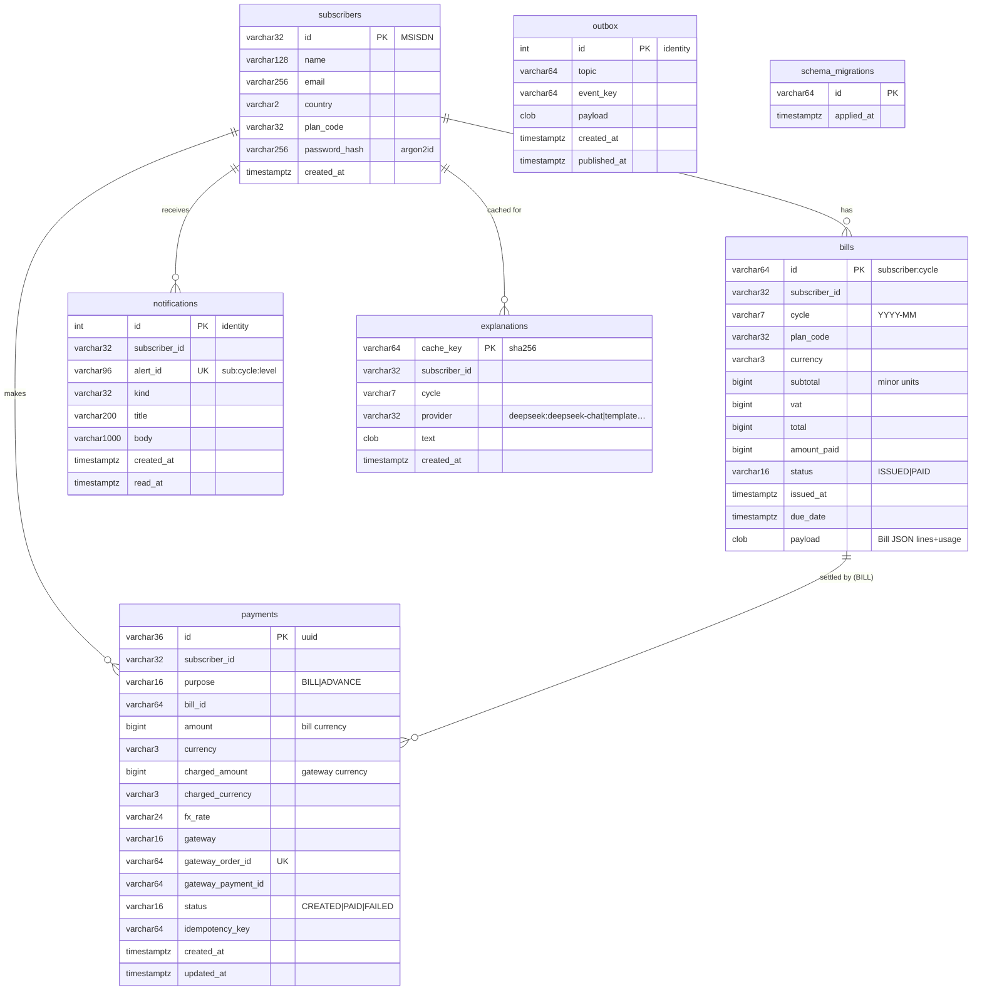
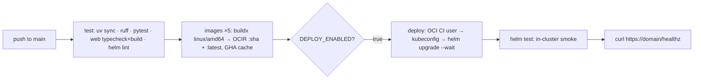

# Low-Level Design

> See [HLD.md](HLD.md) for the architecture and [OPERATIONS.md](OPERATIONS.md) to inspect live data.

## 1. Repository and module map

| Path | Kind | Responsibility | Entrypoints |
|---|---|---|---|
| `libs/telco_common` | Python lib (pure + Valkey state) | Domain model, catalogue, rating engine, explainer, partitioning, codec, flags, usage state + `apply.lua`, demo population | — |
| `services/usage-collector` | FastAPI | Network-facing ingest: auth per source, validate, batch idempotency, partition, gzip, publish | `usage_collector.app:run` |
| `services/usage-aggregator` | Kafka consumers | `usage-aggregator` (apply), `archiver` (raw → Object Storage), `alert-relay` (outbox → topic) | `usage-aggregator`, `archiver`, `alert-relay` |
| `services/core-api` | FastAPI modular monolith | auth, home BFF, bills, PDF, payments, insights/explainer, AI narrator, simulator, admin, SSE; workers: notifier, bill-run, db-init, smoke-test | `core-api`, `notifier`, `bill-run`, `db-init`, `smoke-test` |
| `services/network-emulator` | Typer CLI | Synthetic mediation: `backfill`, `live`, `load` | `network-emulator` |
| `web` | React Router SSR + Express | UI, session cookie, proxies to core-api | `node server.mjs` |
| `deploy/terraform` | IaC | VCN, OKE, ADB, Streaming, Object Storage, Vault, IAM, OCIR | — |
| `deploy/helm/selfcare` | Helm chart | All workloads, Valkey, flagd, ExternalSecrets, ingress/TLS, jobs, smoke test | — |
| `deploy/scripts` | Bash | `bootstrap.sh`, `cluster-addons.sh`, `gh-secrets.sh`, `put-secrets.sh` | — |

### Configuration (environment)

| Prefix / var | Used by | Meaning |
|---|---|---|
| `STREAM_BOOTSTRAP`, `STREAM_USERNAME`, `STREAM_PASSWORD`, `STREAM_USAGE_TOPIC`, `STREAM_ALERTS_TOPIC`, `STREAM_PARTITIONS` | collector, aggregator, notifier | Kafka-compatible OCI Streaming (SASL_SSL/PLAIN; username `tenancy/user/streampool-ocid`, password = auth token) |
| `APP_VALKEY_URL` | all Python | `redis://valkey:6379/0` |
| `APP_DB_DSN`, `APP_DB_USER` (SELFCARE), `APP_DB_PASSWORD` | core-api, notifier, bill-run | ADB TLS connect string, least-privilege app user |
| `APP_JWT_PRIVATE_KEY` (core-api only), `APP_JWT_PUBLIC_KEY` (all services), `APP_REQUIRE_JWT_KEYS` | core-api image | RS256 signing / verify-only; never fall back to a throwaway key in the cluster |
| `APP_DEMO_PASSWORD`, `APP_SEED_DEMO` | core-api | Demo seed |
| `APP_SOURCE_TOKENS` | collector | JSON `{source: token}` |
| `APP_RAZORPAY_KEY_ID/_KEY_SECRET/_WEBHOOK_SECRET` | core-api | Gateway |
| `APP_DEEPSEEK_API_KEY`, `APP_MISTRAL_API_KEY`, `APP_SELFHOSTED_LLM_URL` | core-api | LLM providers |
| `APP_ARCHIVE_BUCKET`, `APP_ARCHIVE_NAMESPACE`, `APP_OCI_AUTH=instance_principal` | archiver | Raw archive |
| `FLAGD_HOST=flagd`, `FLAGD_PORT=8013` | all Python | Feature flags |
| `CORE_API_URL`, `SESSION_SECRET` | web | Backend URL, cookie signing (its own `session-secret`, independent of the token keys) |
| Settings defaults | core-api | `jwt_ttl_s=900`, `ai_daily_limit_per_subscriber=20`, `bill_due_days=14`, `llm_timeout_s=12`, `deepseek_model=deepseek-chat`, `mistral_model=mistral-small-latest` |

## 2. REST API

All customer routes require `Authorization: Bearer <JWT>` and are scoped to the token's subscriber. Personal responses carry `Cache-Control: private, no-store`.

### core-api

| Method & path | Request | Response | Errors |
|---|---|---|---|
| `POST /v1/auth/login` | `{subscriber_id, password}` | `{access_token, token_type, expires_in}` | 401 bad credentials · 429 >10 attempts/15 min |
| `GET /v1/me/home` | — | Snapshot: `as_of`, `subscriber{id,name,country,locale}`, `plan`, `usage{cycle,data_pct,version,data_mb,data_allowance_mb,voice_min,sms,intl_voice_min,roaming_*}`, `unbilled{cycle,currency,subtotal,vat,total,lines[]}`, `outstanding{amount,currency,bill_id}`, `last_bill`, `trend[≤12]`, `notifications[≤10]`, `features{ai_explanations,payments}` | 401, 404 |
| `GET /v1/me/bills?months=1..24` | — | `[BillSummary]` (`id, cycle, total, subtotal, vat, currency, status, amount_paid, outstanding, issued_at, due_date`) | 401 |
| `GET /v1/me/bills/{cycle}` | — | BillSummary + `lines[], usage, vat_rate, plan_code` | 404 |
| `GET /v1/me/bills/{cycle}/pdf` | — | `application/pdf` attachment | 404 |
| `GET /v1/me/bills/{cycle\|current}/explanation?lang=en\|de\|pl&ai=true\|false` | — | `{explanation, narrative, provider, partial}`. `ai=false` = deterministic only (fast SSR path, no budget used) | 404 |
| `POST /v1/me/notifications/{id}/read` | — | 204 | — |
| `GET /v1/me/events` | — | SSE: `notification` events, `ping` every 15 s | 401 |
| `GET /v1/me/usage/scenarios` | — | `[{key,title}]` | — |
| `GET /v1/me/usage/sample.csv` | — | CSV template | — |
| `POST /v1/me/usage/simulate?lang=` | multipart `file` (CSV/JSON) **or** form `scenario` | `{source, compared_to, bill, explanation, narrative, provider}` | 422 invalid usage |
| `POST /v1/me/payments` | header `Idempotency-Key` (8–64), `{purpose: BILL\|ADVANCE, bill_id?}` | 201 `{payment_id,status,amount,currency,charged_amount,charged_currency,fx_rate,purpose,bill_id,gateway,order_id,checkout{provider,key_id,order_id}}`; same key → same order | 404 bill not found/not yours · 409 nothing to pay · 503 payments disabled/not configured/breaker open/no fx rate · 502 gateway rejected |
| `POST /v1/me/payments/{id}/confirm` | `{gateway_payment_id, signature}` | payment (status `PAID`) or `{status: PENDING}` if not captured yet | 400 bad signature · 404 |
| `GET /v1/me/payments/{id}` | — | `{payment_id,status,amount,currency}` | 404 |
| `POST /v1/webhooks/razorpay` | raw body, `X-Razorpay-Signature` | `{ok, settled}` / `{ok, ignored}` | 401 bad signature · 503 not configured |
| `POST /v1/admin/bill-runs/{cycle}?settle_before=` | admin JWT | `{created, skipped_existing}` | 403, 409 cycle not over |
| `GET /v1/admin/pipeline` | admin JWT | per-partition offsets and outbox depth | 403 |
| `GET /healthz`, `GET /readyz`, `GET /metrics` | — | liveness / readiness (Valkey + DB) / Prometheus | 503 degraded |

> No endpoint issues admin tokens today (role claim exists); bill runs run as the `bill-run` CronJob/CLI.

### usage-collector

| Method & path | Request | Response |
|---|---|---|
| `POST /v1/usage-batches` | headers `Authorization: Bearer <source token>`, `X-Source`; body `UsageBatch{batch_id, source, records[1..5000]}` | **202** `{status: accepted, records, messages}` · **200** `{status: duplicate}` · 401 bad token · 403 source mismatch · **409** batch in flight · **503** + `Retry-After: 5` stream unavailable · 422 validation |
| `GET /healthz`, `/readyz` (Valkey ping), `/metrics` | | |

`UsageRecord`: `record_id (8–128)`, `subscriber_id`, `country (DE|PL)`, `kind (USAGE|PLAN_CHANGED)`, `usage_type (DATA bytes|VOICE s|SMS count|ROAMING_DATA bytes|ROAMING_VOICE s|INTL_VOICE s)`, `quantity ≥0`, `roaming_zone (required for roaming)`, `addon_code (required for PLAN_CHANGED)`, `event_time (tz-aware, normalised to UTC)`. Billing cycle = `YYYY-MM` of **event time**.

## 3. Data model (Autonomous DB, schema SELFCARE)

| Table | Owner module | Constraints / indexes | Notes |
|---|---|---|---|
| subscribers | auth/CRM seed | PK id | Seeded from `telco_common.demo` when `APP_SEED_DEMO=true`; seed also writes Valkey `prof:` |
| bills | billing (bill run) | PK `sub:cycle`, UQ `(subscriber_id, cycle)`, IX `ix_bills_sub_cycle` | Insert-if-absent = idempotent bill run; immutable |
| payments | payments | UQ `gateway_order_id`, UQ `(subscriber_id, idempotency_key)` | `amount/currency` = ledger (bill currency); `charged_*` = what the gateway took |
| notifications | notifier | UQ `alert_id`, IX `(subscriber_id, created_at)` | UQ makes alert delivery idempotent |
| explanations | AI narrator | PK cache_key | `sha256(facts, lang, provider, model)` |
| outbox | payments → notifier relay | — | Written in the same transaction as settlement; `published_at` set after broker ack |
| schema_migrations | db.create_schema | — | Forward-only migrations (e.g. `0002_payment_settlement_currency`) |

The schema is created at startup (`create_all` + migrations). The app user `SELFCARE` is created by the Helm `db-init` pre-install/pre-upgrade Job (grants: CREATE SESSION/TABLE/SEQUENCE/VIEW, quota 5G).

## 4. Valkey key schema

All per-partition keys carry the hash tag `{pN}` (N = stream partition), so one message's keys live in one cluster slot.

| Key | Type | Written by | TTL | Content |
|---|---|---|---|---|
| `off:{pN}` | string | apply.lua | — | Last applied stream offset of partition N |
| `seen:{pN}:<msg_id>` | string | apply.lua | 7 days | Message already applied |
| `alerts:{pN}` | stream (MAXLEN ~1,000,000) | apply.lua | — | Outbox: `alert_id, subscriber_id, country, cycle, level, used_bytes, allowance_bytes, pct`; consumer group `relay` |
| `u:{pN}::<cycle>` | hash | apply.lua | 400 days | Counters `DATA`, `VOICE`, `SMS`, `INTL_VOICE`, `ROAMING_DATA:<zone>`, `ROAMING_VOICE:<zone>`, `addon:<code>`, `addon_bytes`; flags `alert:<level>` = offset that raised it |
| `prof:{pN}:` | hash | core-api seed | — | `plan_code, country, allowance_bytes` |
| `batch:<batch_id>` | string | collector | `inflight` 120 s → `done` 7 days | Batch idempotency |
| `rl:login:` / `rl:login-fail-ip:<ip or /64>` / `rl:ai:` | counter | core-api | 900 s / 900 s / 86,400 s | Fixed-window limits: 10 attempts per account, 20 failed logins per IP, 20 AI calls per day |
| `dlq:{pN}` | list (trim 10,000) | aggregator | — | Undecodable (poison) messages |
| `notif:` | pub/sub channel | notifier → core-api SSE | — | Live notification push |

### `apply.lua` (one call per stream message)
1. `offset ≤ GET off:{p}` → return `stale_offset` (crash replay).
2. `EXISTS seen:{p}:msg` → `SET off:{p}=offset`, return `duplicate_message` (re-published chunk).
3. For each (subscriber, cycle) group: `HINCRBY` each field; `EXPIRE` 400 days.
4. `used = DATA + ROAMING_DATA:EU`; `allowance = prof.allowance_bytes + addon_bytes`.
5. For each level (from flag `usage-alert-thresholds`): if `pct ≥ level` and `HSETNX alert:<level>` succeeds → `XADD alerts:{p}`. If an add-on raised the allowance and `pct < level` → `HDEL alert:<level>` (re-arm).
6. `SET seen:{p}:msg EX 7d`; `SET off:{p}=offset`; return `applied, alerts`.

The consumer seeks to `off:{p}+1` on partition assignment. Broker group offsets are committed only for lag visibility.

## 5. Streams and contracts

| Topic | Partitions | Key / partition | Payload | Consumer groups |
|---|---|---|---|---|
| `usage-events` | 4 (fixed) | explicit `crc32(subscriber_id) % 4` | gzip of newline-delimited `UsageRecord` JSON, ≤2,000 records, ≤900 KB; headers `msg_id = sha256(batch_id|partition|chunk)[:32]`, `batch_id` | `usage-aggregator`, `raw-archiver` |
| `usage-alerts` | 1 | key = subscriber_id; header `alert_id` | `{"alert_id":":<cycle>:<level>","subscriber_id","country","cycle","level","used_bytes","allowance_bytes","pct"}` | `notifier` |
| `payment-events` | 1 | key = subscriber_id | `{"type":"PAYMENT_SUCCEEDED","payment_id","subscriber_id","amount","currency","purpose","bill_id","gateway","gateway_payment_id"}` | (downstream: ERP, analytics) |

Retention: 48 h. Raw archive objects: `raw/usage-events/dt=YYYY-MM-DD/p=
/<first>-<last>.jsonl.gz` (flush at 4 MB or 60 s). Archive delivery is at-least-once, and reconciliation dedupes by `record_id`. Notifier skips alerts for cycles earlier than the current month (backfill replay).

## 6. Rating engine (`billing.py`, `catalog.py`)

| Plan | Country | Fee (net) | Data | Voice / SMS | Overage | Intl/min |
|---|---|---|---|---|---|---|
| DE-S Mobile S | DE (EUR, VAT 19%) | 19.95 | 10 GB | unlimited | THROTTLE | 0.29 |
| DE-M Mobile M | DE | 34.95 | 30 GB | unlimited | THROTTLE | 0.19 |
| DE-FLEX Mobile Flex | DE | 9.95 | 3 GB | 200 min / 100 SMS | CHARGE 0.009/MB, 0.09/min, 0.09/SMS | 0.39 |
| PL-S Mobile S | PL (PLN, VAT 23%) | 35.00 | 15 GB | unlimited | THROTTLE | 0.99 |
| PL-FLEX Mobile Flex | PL | 25.00 | 5 GB | 300 / 300 | CHARGE 0.035/MB, 0.29/min, 0.19/SMS | 1.49 |

Roaming (non-EU): DE Z2 0.0199/MB, 0.49/min; Z3 0.0999/MB, 1.99/min. PL Z2 0.086/MB, 1.99/min; Z3 0.43/MB, 8.99/min. Add-ons: DE-DATA-5GB 9.99, DE-DATA-20GB 19.99, PL-DATA-5GB 25.00.

Rules:
- Money is in integer minor units. Per-unit rates are Decimal. Each line rounds half-up.
- Data is rounded **up to the started MB** (1 MB = 10⁶ B), voice up to the started minute (aggregate seconds).
- **EU roam-like-at-home:** `ROAMING_DATA:EU` and `ROAMING_VOICE:EU` count against the domestic allowance at no extra charge.
- Allowance = plan data + Σ add-on MB. Overage is charged only when the policy is `CHARGE`. With `THROTTLE` the network slows down at 100% instead.
- VAT = round_half_up(subtotal × rate). Total = subtotal + VAT.
- The same `rate()` prices the unbilled running total, the issued bill and simulations.

**Explainer (`explainer.py`):**
- Drivers are line-level deltas between the current and previous bill, sorted by |Δ| amount. Each has a quantity comparison as its detail.
- Top usage drivers are the non-plan lines by amount, with their share of variable charges.
- Usage changes (data, calls, international calls, non-EU roaming) are reported as a % change.
- Facts are sentences built only from these numbers. Direction is `UP`, `DOWN`, `SAME` or `FIRST_BILL`.

**AI grounding check (`services/ai.py`):**
1. Extract every number token from the facts plus usage changes plus the cycle labels.
2. Normalise each token by removing separators. Allow both the full number and its integer part.
3. Every number in the model's answer must be in that allowed set, or be a single digit.
4. If any number fails, the answer is discarded and the template is used.

## 7. Feature flags (flagd, `deploy/helm/selfcare/values.yaml`)

| Key | Variants (default **bold**) | Safe fallback if flagd is unreachable | Controls |
|---|---|---|---|
| `ai-explanations` | **on** / off | `false` | LLM narration at all |
| `ai-provider` | **deepseek** / mistral / selfhosted / template | `deepseek` | Which LLM (per country for GDPR) |
| `payments-enabled` | **on** / off | `true` | Kill switch for payments |
| `payment-gateway` | **razorpay** / cashfree | `razorpay` | Gateway adapter (only Razorpay implemented) |
| `payment-settlement` | native / **inr** (`fx: EUR 90.0, PLN 21.0`) | `native` | Gateway charge currency (UPI is INR-only) |
| `usage-alert-thresholds` | **standard** [50,80,100] / strict [50,75,90,100] | [50,80,100] | Alert levels (cached 30 s in the aggregator) |
| `throttle-at-100` | **on** / off | `true` | Reserved for the policy integration |

Every evaluation sends `targetingKey = subscriber`, attribute `country`.

## 8. Kubernetes resources (Helm chart `selfcare`, namespace `selfcare`)

| Resource | Replicas / schedule | Notes |
|---|---|---|
| Deployment `usage-collector` + Service + HPA 1–6 | 1 | 100m/192Mi |
| Deployment `usage-aggregator` | 2 | ≤ partitions |
| Deployment `raw-archiver`, `alert-relay`, `notifier` | 1 each | |
| Deployment `core-api` + Service + HPA 2–8 + PDB | 2 | readiness = Valkey + DB |
| Deployment `web` + Service + HPA 2–6 + PDB | 2 | UID 1000, Express `server.mjs` |
| Deployment `flagd` (v0.18.2) + Service :8013 | 1 | ConfigMap `flagd-flags`, hot reload |
| Deployment `network-emulator-live` | 1 | Live demo traffic every 60 s |
| StatefulSet `valkey` (valkey 8.1) + PVC 50Gi `oci-bv` | 1 | AOF everysec, `noeviction`, maxmemory 1gb |
| Job `db-init` | pre-install/upgrade hook | Creates SELFCARE user |
| Job `demo-backfill` | post-install hook | 12-month backfill → bill run (`--wait-quiet-seconds 30`, settle all but the last cycle) |
| CronJob `bill-run` | `0 2 1 * *` | Close the previous cycle |
| SecretStore `oci-vault` + ExternalSecrets `selfcare-secrets`, `ocir-pull` (hooks), `selfcare-<third-party>` (from `thirdPartySecrets`) | | Instance-principal auth |
| Ingress `selfcare` (Traefik) + Issuer `letsencrypt` | | Routes `/` → web, `/v1/webhooks/razorpay` → core-api |
| Pod `selfcare-smoke` | `helm test` | 15 checks |

All pods: `enableServiceLinks: false`, non-root, read-only root FS, capabilities dropped, seccomp RuntimeDefault, `imagePullSecrets: ocir-pull`.

Cluster add-ons (`cluster-addons.sh`): External Secrets, cert-manager, metrics-server, Traefik (LB annotations flexible 10/10 Mbps, http→https redirect with ACME bypass), RoleBinding `admin` in `selfcare` for the CI user only.

## 9. CI/CD (`.github/workflows/ci.yml`)

## 10. Testing strategy

| Layer | What | Where |
|---|---|---|
| Unit + API | **33 tests**: rating (rounding, VAT, roaming, add-ons, PLN), explainer, codec, partitioning, Lua apply (replay, re-publish, add-on re-arm, cycle rollover), collector publishing, API (auth, IDOR, idempotent payments, dual-path settlement, webhook signature, simulation, INR settlement), AI (grounding, cache, breaker, no PII) | `libs/*/tests`, `services/*/tests` (SQLite + fakeredis) |
| In-cluster smoke | 15 checks against live services after each deploy | `core_api.smoke`, `helm test` |
| Load | 3k and 15k rec/s through the real stream | `deploy/loadtest/job.yaml`, [LOADTEST.md](LOADTEST.md) |
| Browser e2e | Real login form → every page → Razorpay checkout, desktop + mobile screenshots (being added with Playwright) | `web/e2e` |

Known gap: SQLite doesn't enforce VARCHAR lengths, so a test asserts the cycle shape explicitly. Oracle-specific behaviour is covered by the smoke test.
