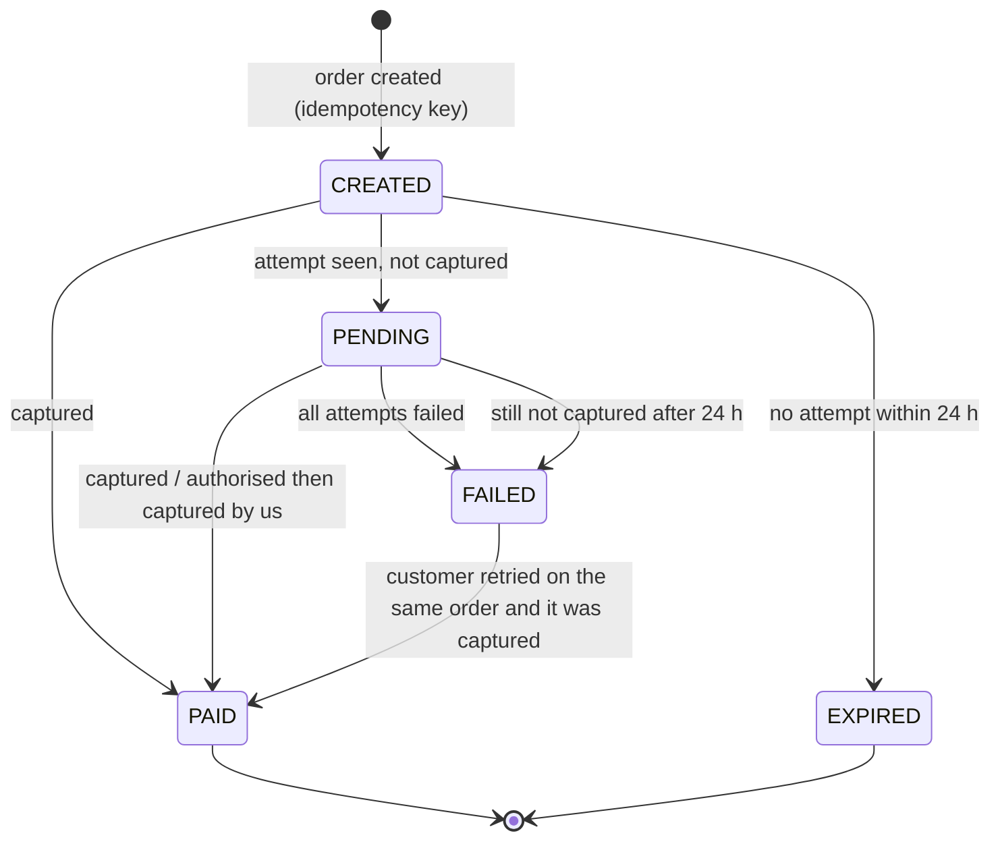

# Payments: Razorpay end to end

## Principle
**The gateway's status API is the only source of truth.** The browser callback, Razorpay webhooks and our
reconciler are all just *triggers* that cause `reconcile_order()` to call
`GET /v1/orders/{id}` and `GET /v1/orders/{id}/payments` and apply the result. Webhook and callback payloads
are verified (HMAC) but **never** used to set a status. That makes the order of events irrelevant.

## State machine

- **PAID is terminal.** It's enforced in SQL with `UPDATE … WHERE status <> 'PAID'`, so it happens exactly once.
- **On settlement,** the bill balance, the payment row and the `PAYMENT_SUCCEEDED` outbox event are written in **one transaction**. Advance payments are credited on the next bill run.
- **`settled_by`** records which trigger observed the capture first: browser, webhook, reconciler or poll.

## Scenarios
| Situation | Outcome |
|---|---|
| Customer double-taps Pay | same idempotency key, same order |
| Browser says "success" but Razorpay hasn't captured yet | stays CREATED/PENDING; the reconciler picks it up |
| `payment.failed` (user dropped) arrives **after** `payment.captured` | status API says captured, stays PAID |
| Failed attempt, then a successful retry on the same order | ends PAID |
| Payment authorised but not captured (manual-capture account) | we capture via the API, then PAID |
| Webhook never arrives / our system was down | reconciler: everything overdue is checked at startup |
| Duplicate webhooks | idempotent (status API + terminal PAID) |
| Abandoned checkout | EXPIRED after 24 h |
| Razorpay API down | circuit breaker; the check is rescheduled with backoff |

## Reconciler (worker)
Every 15 s it picks the non-final payments whose `next_check_at` is due. It checks each one and schedules the next check:
- **exponential** (default): `delay(n) = min(1 h, 30 s · 2ⁿ)`, giving 30 s, 60 s, 2 min, 4 min, 8 min…
- **polynomial** (option): `delay(n) = min(1 h, a·n² + b·n + c)` with (a, b, c) = (20, 10, 30), giving 30 s, 60 s, 130 s, 240 s…

Columns on `payments`: `gateway_status`, `check_attempts`, `next_check_at`, `last_checked_at`, `settled_by` (migration 0006).

## Webhook
Configure in the Razorpay Dashboard → Webhooks:
- **URL:** `https://130.210.124.37.sslip.io/v1/webhooks/razorpay`
- **Secret:** the value stored in OCI Vault as `dt-selfcare-razorpay-webhook-secret`
- **Events:** `payment.authorized`, `payment.captured`, `payment.failed`, `order.paid`

## Currency
- **Bills and the ledger stay in the bill's own currency** (EUR/PLN).
- **The demo gateway is charged in INR** (`payment-settlement` = `inr`). Razorpay treats any non-INR order as an international payment, and international payments can't be enabled on a test-mode account, so EUR orders would be declined ("International cards are not supported"). The payment records the bill amount, the charged INR amount and the FX rate, and the checkout shows the conversion to the customer.
- **Test cards (domestic, work in test mode):** Visa `4100 2800 0000 1007`, Mastercard `5500 6700 0000 1002`; any future expiry, any CVV. UPI: `success@razorpay`.
- **EU production:** `native` on an EU gateway (Adyen/Stripe) charging EUR/PLN directly, with no conversion.

## Tests
`services/core-api/tests/test_api.py`:
- idempotency and single settlement
- out-of-order failed webhook after capture
- failed attempt then a successful retry
- catch-up after downtime and expiry
- backoff schedules
- authorised payments are captured
