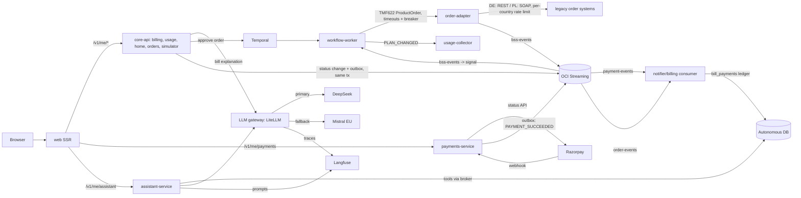

# Platform: services, LLM gateway, durable workflows, LLM observability

## Services and data ownership
| Service | Scales on | Owns | Talks to others via |
|---|---|---|---|
| usage-collector, usage-aggregator, raw-archiver, alert-relay | ingest rate, partitions | Valkey usage state, raw archive | OCI Streaming |
| **core-api** | page traffic | subscribers, bills, notifications, orders | REST; consumes `payment-events` (billing) |
| **payments-service** | checkouts | `payments` | Razorpay status API; emits `PAYMENT_SUCCEEDED` (transactional outbox) |
| **assistant-service** | concurrent LLM streams (SSE) | `context_docs`, `agent_traces` | LLM gateway; read-only tools |
| notifier | alerts and events | — | streams; Valkey pub/sub |
| workflow-worker | workflow activities | — | Temporal; order-adapter (HTTP); consumes `bss-events` |
| **order-adapter** | order submissions | legacy emulator state (`bss_orders`) | TMF622 API; publishes `bss-events` |
| llm-gateway | LLM request rate | provider keys | DeepSeek, Mistral, Langfuse |

- **Payments → billing is event-driven.** payments-service never writes billing tables.
  - Billing applies `PAYMENT_SUCCEEDED` through the `bill_payments` ledger (PK = payment id), so redeliveries do nothing.
  - The bill shows PAID within a few seconds of the capture (outbox relay → stream → consumer).
  - The outbox relay (idempotent producer) marks only rows with a successful delivery report as published; a rejected message is retried.
  - The billing consumer commits only applied events and re-reads a failed one (e.g. DB down), so no payment is skipped. The reconciler's `apply_missing` sweep applies any captured bill payment still missing from its bill after 2 min.
- **notifier supervision:** its worker threads (alerts, outbox relay, spine, billing, order projections) survive DB blips; if one dies anyway, `main()` exits so Kubernetes restarts the pod (the liveness probe only sees the metrics port). The order-events consumer commits per projected event and re-reads a failed one.
- **Honest limit:** the services still share one Autonomous DB, with table ownership as above. The assistant's read-only tools read billing tables directly. The target is a database per service, with tools calling core-api's read APIs. That's the next extraction step, gated on team topology.

## LLM gateway (LiteLLM)
- **Routing:** services call model alias `billing-llm`. The gateway routes it to **DeepSeek** and falls back to **Mistral (EU)** after errors, with 2 retries and `retry-after`.
- **Failing providers:** a failing deployment is cooled down for 30 s after 3 failures.
- **Rate limits** per deployment (rpm/tpm), configured in `values.yaml` under `llmGateway`.
- **Keys:** provider keys exist **only** in the gateway, synced from OCI Vault. Services hold a gateway key.
- **Tracing:** every call is sent to **Langfuse** (`success_callback`/`failure_callback`) with metadata: trace name, session id, pseudonymous user hash, stage.
- **Client behaviour:** the service-side client is **async** (`httpx.AsyncClient`), limits concurrency per pod (`llm_max_concurrency`) and retries the gateway with jittered backoff.

## Orders: events, adapters, bill-day spikes
- **`order-events` (Kafka/OCI Streaming).** Every order status change (PROPOSED → APPROVED → SUBMITTED →
  COMPLETED/FAILED, DECLINED) is written together with an `ORDER_STATUS_CHANGED` outbox row **in the same
  DB transaction** and relayed to the stream. The `order-projections` consumer updates the
  home-screen cache, the assistant's context and, on terminal states, the customer notification
  (idempotent: `alert_id = order:<id>:<status>`). Workflows never write notifications themselves.
- **Status writes are compare-and-set** (`set_status(..., expect=...)`): approve only from PROPOSED/DECLINED, decline
  only from PROPOSED, finish only from APPROVED/SUBMITTED. Approve and decline at the same moment can't both win, and a
  retried finish or a late write can't regress an order. If the workflow can't be started, the approval is rolled
  back ("nothing was charged, try again", 503). Workflows start with `ALLOW_DUPLICATE_FAILED_ONLY`: a completed order
  can't run twice, a failed one can be retried.
- **`bss-events`.** The legacy result (TMF622 state) is published by the order-adapter. The worker's
  `order-workflows` consumer turns it into a workflow signal. Measured live: 0.7 s from legacy result to
  signal. If an event is lost, the workflow asks the adapter for the state every 45 s.
- **order-adapter: Temporal never calls a legacy system.** Activities call one internal API (TMF622
  ProductOrder), which picks the country adapter (DE REST, PL SOAP).
- **Bill-day spikes wait in a queue.** The legacy-facing activities (submit, status) run on **one Temporal
  task queue per country** (`legacy-bss-DE`, `legacy-bss-PL`). The Temporal server caps that queue's
  dispatch rate across all worker pods at the legacy system's capacity (`bss_max_rps`). On a spike, calls
  wait durably in the queue (roughly in arrival order; task queues are partitioned) and flow out at
  exactly the capacity rate: no 429 churn, no growing backoff. The customer's card says
  "In line for the network system…", and a notification arrives when the order is done.
- **Safety net.** The adapter still enforces each country's capacity (Valkey 1-second window). If it ever
  answers 429 + Retry-After, the activity backs off and the card switches to an explicit "Queued" message.
- **Tariff change** (`PlanChangeWorkflow`) shares the same activities and adapters (`action: modify`).
  The switch applies from today and is pro-rated (see below). It also updates the real-time profile (`prof:`
  allowance), and after an upgrade re-arms the alert levels the customer is now below.
  Available from the `/plan` page and from the assistant (`propose_plan_change`, approval card).

### Day-level usage (trend chart + exact pro-rating)
- The aggregator's exactly-once apply writes, next to each cycle total, the same increment into a per-day
  field of the subscriber's monthly hash: `DATA` and `DATA@21`. The day is the **CDR's event day** (UTC),
  so a late CDR lands on the day it happened. Same Lua call: the days always add up to the totals, replays
  stay no-ops, and alerts still read the totals.
- **Why not a separate daily key per subscriber:** at 50M subscribers that is ~1.5B keys/month of
  per-key overhead. Fields inside the existing hash cost ~10-20 bytes each in Valkey's compact listpack
  encoding (`hash-max-listpack-entries 512`). A typical subscriber uses 3-4 usage types, so a month is
  ~120 extra fields, ~2 KB. 50M × 2 KB ≈ 100 GB across a Valkey cluster: a sizing decision, not a design
  limit. The hashes already live 13 months, so past months' daily charts cost nothing extra.
  Long-term history beyond 13 months belongs in the raw archive / a columnar store, not in Valkey.
- **Backfill for usage recorded before day fields existed:** `python -m core_api.backfill_daily [--apply]` rebuilds the
  missing `<counter>@DD` fields from the raw CDR archive. It fills only the gap (total minus existing days), never touches
  totals, writes with WATCH/MULTI so a live CDR can't be double counted, and is idempotent. Anything the archive can't
  explain is reported, never invented. Run on prod on 22 Nov 2026: 74 subscriber-months, 0 unexplained.
- `GET /v1/me/usage/daily?cycle=` serves the chart (Overview: current month with allowance pace and
  month-end projection; each bill: that month).
- **Exact pro-rating:** with day detail, each tariff segment is rated on its own tariff, its own
  pro-rated allowance and its own days of usage (`rate_segments`). Months recorded before day detail
  existed fall back to blended allowances. An add-on is charged in the segment it was bought in; its unused volume
  carries into the following segments of the month.
- **Mid-month join:** a customer who joined during the month and has no earlier bill pays fee and allowances only
  from the join day (`first_billable_day`). Existing customers are never cut.
- **Tariff in force:** bills and late-usage adjustments are priced on the tariff of that month (`plan_at`, from
  `plan_changes`), so a switch on the 1st before the bill run doesn't re-price the closed month.

### Tariff change pro-rating
- Every switch is recorded in `plan_changes` (keyed by order id, written in the same transaction as the
  switch, so a retried activity adds nothing).
- For each cycle the history gives day segments; **the change day is billed on the new tariff**. A switch
  on 21 Nov in a 30-day cycle gives *Mobile Flex monthly fee, 20 of 30 days* + *Mobile M monthly fee, 10 of
  30 days*. Several switches in one cycle give several lines.
- **Allowances** (data, minutes, SMS) are pro-rated the same way; unlimited if either tariff is unlimited.
- **Usage** is split by day (see above), so each tariff prices its own days. Only cycles recorded before
  per-day counters existed fall back to "priced at the tariff in force at cycle end".
- The approval card shows this month's pro-rated fee before the customer approves; the live unbilled
  amount and the bill run both use the same segments (cached in the home read model, invalidated by
  `order-events`).

## Timeouts and circuit breakers
Every service-to-service call has a **connect timeout** (1 s) and a **read budget**, plus a **circuit breaker**:
after 5 consecutive failures (timeout, connection error, 5xx) the circuit opens and fails fast; after a cool-down
one trial request decides whether it closes. 4xx and 429 don't trip it.

| Caller → callee | Connect / read | Breaker |
|---|---|---|
| web BFF → core-api, payments, assistant | fetch timeout 5 s (30 s explanation, evidence re-scan and what-if simulation, 120 s assistant stream; SSR `streamTimeout` 35 s) | **opossum**: ≥50% of ≥5 calls fail in 10 s → open 20 s → half-open trial |
| workflow activities → order-adapter | 1 s / 5 s | 5 fails → open 30 s → Temporal retries |
| workflow activities → usage-collector | 1 s / 10 s | Temporal retry policy |
| services → LLM gateway | per stage, with retries/backoff | gateway cooldown + fallback |

### What the customer sees when a circuit is open
| Service down | BFF fallback | Customer sees |
|---|---|---|
| core-api | last good snapshot (per customer, ≤ 1 h, in BFF memory) | their account with a banner "Showing your account as of HH:MM, live updates are delayed"; the page re-checks every 20 s and swaps in live data. No snapshot → a styled "We'll be right back" page with Try again. |
| payments-service | `degraded: ["payments"]` in the page data | Pay buttons replaced by "Payments are briefly unavailable. Your bill and due date are not affected." |
| assistant-service | `degraded: ["assistant"]` | banner on the Assistant page; input disabled; the rest of the app works |
| LLM explanation | section-level error boundary | "The explanation isn't available right now. Your bill breakdown above is complete and exact." |

A circuit opens on observed failures, so the first few requests after an outage still fail (with a clear
message) before the up-front degradation kicks in.

## New deployments reach open tabs

- **Version:** each web build has a hash (React Router's manifest version). The server sends it on every response as `X-App-Version` and serves it at `/version` (no-store).
- **Detection:** an open tab compares it on every same-origin request, with a `/version` check every 60 s while visible and on focus.
- **Action:** once the tab is outdated, the next click on any link or button does a full load of the new version (the link's target, or the same page for a button) instead of running old code. A toast confirms the update. A missing old code chunk also triggers a reload.
- **Rolling deploys:** a tab never reloads towards a version it has already loaded, so it can't bounce between old and new pods during the rollout.
- **Test:** `e2e/journey.spec.ts` ("new deployment") runs on every deploy.

## Rolling deploys on a small node

- **The demo runs on one 2-vCPU node.** CPU *requests* sit near 85% while actual use is about 10%, so a rolling update has no room for a surge pod on top of every workload.
- **In-place updates:** workloads with at least 2 pods (web, core-api, payments, aggregator, llm-gateway) and background consumers (alert-relay, notifier, raw-archiver, workflow-worker) replace one pod at a time (`maxSurge 0, maxUnavailable 1`).
  - The PDB (`minAvailable 1`) keeps one pod serving.
  - Consumers resume from their committed offset, and Temporal tasks wait in their queue.
- **Surge-first:** single pods that serve requests (assistant, collector, order-adapter, flagd) start their replacement first, so there is no gap.
- **Production:** a node pool with headroom (or the cluster autoscaler) restores surge-first everywhere.

## CDR evidence re-scan
- "Re-sum my CDRs" re-reads the customer's raw CDRs from Object Storage and reconciles them with Valkey.
- **Index:** archive objects are immutable, so each is read once to learn which customers it holds
  (`evidx:{p}:<customer-set hash>` in Valkey, 35 days). Later scans download only the customer's own objects.
- **Single flight:** concurrent requests for the same evidence wait for the first scan; the scan lock is released on failure too. The BFF gives the call 30 s.
- **Current month:** the archive is written about once a minute while the live meter updates at once, so archive < meter is shown as "still arriving", not as a mismatch. More in the archive than counted is a mismatch.
- **Why:** a cold scan read every object of the partition (about 7 s), longer than the 5 s BFF budget, so it was aborted
  and counted against the core-api breaker. That was the e2e flake on the bill page.

## Live demo traffic
`network-emulator live` releases each persona's deterministic CDRs at their own event time (06:00 to 23:59 UTC), so a
day of live traffic equals exactly one day of the persona's usage. It catches up from midnight on start, and the
collector drops record ids it has already accepted. (Before 22 Nov it re-sampled 5% of a whole day every minute,
about 72 days of usage per day, which inflated November.)

## Bill day
- The `bill-run` CronJob issues the bills (init container), then **`explain-batch`** runs: it warms every
  customer's home-screen cache and pre-generates the AI explanation at a fixed rate (`billDay.explainRps`).
  Customers opening the app get both from cache: no DB stampede, no LLM stampede.
- Read path measured live (one 1-OCPU node, 32 concurrent): **246 rps, 0 errors, p50 88 ms, p95 380 ms,
  cache hit 99.9%** (`deploy/loadtest/read-path-job.yaml`).
- Edge: Traefik rate limit per client IP (40 rps, burst 120); verified with a 400-request burst: 176 × 200, 224 × 429.

## Durable write actions (Temporal)
- **Broker tiers:** `read` tools execute; the **`propose`** tier (`propose_addon`) only creates a PROPOSED order with a preview. The customer approves in the UI (approval card in chat, or "Add data").
- **Approve** → `start_workflow(AddonPurchaseWorkflow, id=order_id)`. Because the workflow id is the order id, a double click can't start two workflows.
- **Workflow steps:**
  1. Validate.
  2. Submit to the legacy BSS (simulated: 20–60 s, ~10% rejections).
  3. Durable wait for its signal, re-checking with `bss_status` every 45 s in case the callback was lost (an adapter outage just means "ask again"); one last status check, then give up after 30 min. The first result wins: a later, conflicting callback can't flip it.
  4. On confirmation, apply as `PLAN_CHANGED` through the **real usage pipeline**, as source `core-orders` with its own token when `order-source-token` is configured (the collector then accepts add-on events only from it). The record id is `order-<id>`, so a retried activity is deduplicated by the collector; a quarantined record fails the activity so it retries. After confirmation, apply and finish retry without an attempt cap.
  5. Complete and notify.
- **On rejection, timeout or an activity that ran out of retries before confirmation:** compensate (mark FAILED, notify; nothing was applied or charged). No order stays APPROVED/SUBMITTED forever.
- **Durability:** a worker or server pod restart resumes from history; the server stores its SQLite DB on a volume. In production: Temporal Cloud or an HA cluster on Postgres/Cassandra, with the same code.
- **Tests:** `tests/test_workflow.py` runs 4 paths on Temporal's time-skipping test server:
  - confirmed
  - rejected
  - lost callback, found by polling
  - never confirmed

## Observability, evaluations, prompt versioning (Langfuse, EU cloud)
- **Traces:** every LLM call (grader, agent turns, repairs, explanation) carries cost, tokens, cached tokens and latency, grouped by session.
- **Prompt management:** `assistant-system` and `explainer-system` are fetched with label `production`, cached 5 min, with the repo default as fallback.
  - `prompt-seed` publishes the repo versions; it runs as a post-install/post-upgrade Helm hook on every deploy, publishing only when the text changed and never failing the deploy.
  - Rollback = move the label.
  - The active version is recorded in every trace (`prompt_version`).
- **Evaluations:** dataset `billing-assistant-golden` (9 questions over the demo population), run as experiment `assistant-golden` (`deploy/loadtest/evals-job.yaml`) with these evaluators:
  - `grounded`
  - `mentions`
  - `used_tools`
  - `cost_usd`

  Compare runs across prompt versions and models.

## Sessions
Sessions use rotating refresh tokens:
- **Access JWT:** 15 min.
- **Refresh token:** 30 days, stored only as a hash in Valkey, rotated on every use.
- **Parallel refreshes:** a 30 s grace window covers requests that refresh at the same time.
- **Logout** revokes the refresh token.

The web server refreshes transparently, so users stay signed in across deploys. A root middleware (`root.tsx`) attaches the rotated session cookie to every response that refreshed, resource routes included (API, PDF, SSE, orders, assistant); before, those dropped it and the next click used the dead refresh token.
