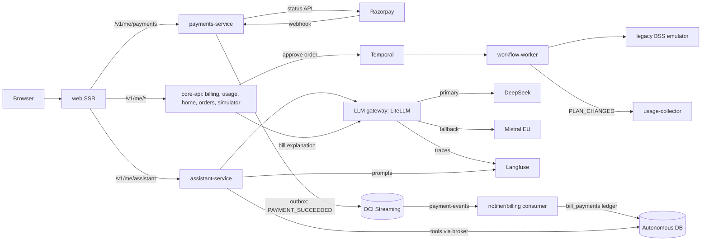

# Platform: services, LLM gateway, durable workflows, LLM observability

## Services and data ownership
| Service | Scales on | Owns | Talks to others via |
|---|---|---|---|
| usage-collector, usage-aggregator, raw-archiver, alert-relay | ingest rate, partitions | Valkey usage state, raw archive | OCI Streaming |
| **core-api** | page traffic | subscribers, bills, notifications, orders | REST; consumes `payment-events` (billing) |
| **payments-service** | checkouts | `payments` | Razorpay status API; emits `PAYMENT_SUCCEEDED` (transactional outbox) |
| **assistant-service** | concurrent LLM streams (SSE) | `context_docs`, `agent_traces` | LLM gateway; read-only tools |
| notifier | alerts and events | — | streams; Valkey pub/sub |
| workflow-worker | workflow activities | — | Temporal; usage-collector |
| llm-gateway | LLM request rate | provider keys | DeepSeek, Mistral, Langfuse |

- **Payments → billing is event-driven.** payments-service never writes billing tables.
  - Billing applies `PAYMENT_SUCCEEDED` through the `bill_payments` ledger (PK = payment id), so redeliveries do nothing.
  - The bill shows PAID within a few seconds of the capture (outbox relay → stream → consumer).
- **Honest limit:** the services still share one Autonomous DB, with table ownership as above. The assistant's read-only tools read billing tables directly. The target is a database per service, with tools calling core-api's read APIs. That's the next extraction step, gated on team topology.

## LLM gateway (LiteLLM)
- **Routing:** services call model alias `billing-llm`. The gateway routes it to **DeepSeek** and falls back to **Mistral (EU)** after errors, with 2 retries and `retry-after`.
- **Failing providers:** a failing deployment is cooled down for 30 s after 3 failures.
- **Rate limits** per deployment (rpm/tpm), configured in `values.yaml` under `llmGateway`.
- **Keys:** provider keys exist **only** in the gateway, synced from OCI Vault. Services hold a gateway key.
- **Tracing:** every call is sent to **Langfuse** (`success_callback`/`failure_callback`) with metadata: trace name, session id, pseudonymous user hash, stage.
- **Client behaviour:** the service-side client is **async** (`httpx.AsyncClient`), limits concurrency per pod (`llm_max_concurrency`) and retries the gateway with jittered backoff.

## Durable write actions (Temporal)
- **Broker tiers:** `read` tools execute; the **`propose`** tier (`propose_addon`) only creates a PROPOSED order with a preview. The customer approves in the UI (approval card in chat, or "Add data").
- **Approve** → `start_workflow(AddonPurchaseWorkflow, id=order_id)`. Because the workflow id is the order id, a double click can't start two workflows.
- **Workflow steps:**
  1. Validate.
  2. Submit to the legacy BSS (simulated: 20–60 s, ~10% rejections).
  3. Durable wait for its signal, re-checking with `bss_status` every 45 s in case the callback was lost; give up after 30 min.
  4. On confirmation, apply as `PLAN_CHANGED` through the **real usage pipeline**. The record id is `order-<id>`, so a retried activity is deduplicated by the collector.
  5. Complete and notify.
- **On rejection or timeout:** compensate (mark FAILED, notify; nothing was applied).
- **Durability:** a worker or server pod restart resumes from history; the server stores its SQLite DB on a volume. In production: Temporal Cloud or an HA cluster on Postgres/Cassandra, with the same code.
- **Tests:** `tests/test_workflow.py` runs 4 paths on Temporal's time-skipping test server:
  - confirmed
  - rejected
  - lost callback, found by polling
  - never confirmed

## Observability, evaluations, prompt versioning (Langfuse, EU cloud)
- **Traces:** every LLM call (grader, agent turns, repairs, explanation) carries cost, tokens, cached tokens and latency, grouped by session.
- **Prompt management:** `assistant-system` and `explainer-system` are fetched with label `production`, cached 5 min, with the repo default as fallback.
  - `prompt-seed` publishes the repo versions.
  - Rollback = move the label.
  - The active version is recorded in every trace (`prompt_version`).
- **Evaluations:** dataset `billing-assistant-golden` (9 questions over the demo population), run as experiment `assistant-golden` (`deploy/loadtest/evals-job.yaml`) with these evaluators:
  - `grounded`
  - `mentions`
  - `used_tools`
  - `cost_usd`

  Compare runs across prompt versions and models.

## Sessions
Sessions use rotating refresh tokens:
- **Access JWT:** 15 min.
- **Refresh token:** 30 days, stored only as a hash in Valkey, rotated on every use.
- **Parallel refreshes:** a 30 s grace window covers requests that refresh at the same time.
- **Logout** revokes the refresh token.

The web server refreshes transparently, so users stay signed in across deploys.
