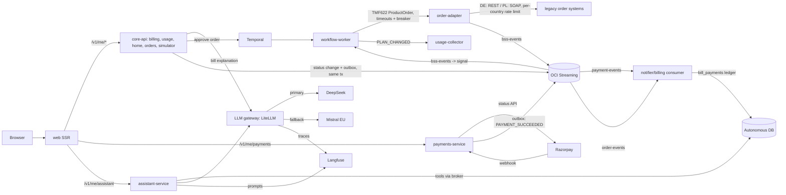

# Platform: services, LLM gateway, durable workflows, LLM observability

## Services and data ownership
| Service | Scales on | Owns | Talks to others via |
|---|---|---|---|
| usage-collector, usage-aggregator, raw-archiver, alert-relay | ingest rate, partitions | Valkey usage state, raw archive | OCI Streaming |
| **core-api** | page traffic | subscribers, bills, notifications, orders | REST; consumes `payment-events` (billing) |
| **payments-service** | checkouts | `payments` | Razorpay status API; emits `PAYMENT_SUCCEEDED` (transactional outbox) |
| **assistant-service** | concurrent LLM streams (SSE) | `context_docs`, `agent_traces` | LLM gateway; read-only tools |
| notifier | alerts and events | — | streams; Valkey pub/sub |
| workflow-worker | workflow activities | — | Temporal; order-adapter (HTTP); consumes `bss-events` |
| **order-adapter** | order submissions | legacy emulator state (`bss_orders`) | TMF622 API; publishes `bss-events` |
| llm-gateway | LLM request rate | provider keys | DeepSeek, Mistral, Langfuse |

- **Payments → billing is event-driven.** payments-service never writes billing tables.
  - Billing applies `PAYMENT_SUCCEEDED` through the `bill_payments` ledger (PK = payment id), so redeliveries do nothing.
  - The bill shows PAID within a few seconds of the capture (outbox relay → stream → consumer).
- **Honest limit:** the services still share one Autonomous DB, with table ownership as above. The assistant's read-only tools read billing tables directly. The target is a database per service, with tools calling core-api's read APIs. That's the next extraction step, gated on team topology.

## LLM gateway (LiteLLM)
- **Routing:** services call model alias `billing-llm`. The gateway routes it to **DeepSeek** and falls back to **Mistral (EU)** after errors, with 2 retries and `retry-after`.
- **Failing providers:** a failing deployment is cooled down for 30 s after 3 failures.
- **Rate limits** per deployment (rpm/tpm), configured in `values.yaml` under `llmGateway`.
- **Keys:** provider keys exist **only** in the gateway, synced from OCI Vault. Services hold a gateway key.
- **Tracing:** every call is sent to **Langfuse** (`success_callback`/`failure_callback`) with metadata: trace name, session id, pseudonymous user hash, stage.
- **Client behaviour:** the service-side client is **async** (`httpx.AsyncClient`), limits concurrency per pod (`llm_max_concurrency`) and retries the gateway with jittered backoff.

## Orders: events, adapters, bill-day spikes
- **`order-events` (Kafka/OCI Streaming).** Every order status change (PROPOSED → APPROVED → SUBMITTED →
  COMPLETED/FAILED, DECLINED) is written together with an `ORDER_STATUS_CHANGED` outbox row **in the same
  DB transaction** and relayed to the stream. The `order-projections` consumer updates the
  home-screen cache, the assistant's context and, on terminal states, the customer notification
  (idempotent: `alert_id = order:<id>:<status>`). Workflows never write notifications themselves.
- **`bss-events`.** The legacy result (TMF622 state) is published by the order-adapter. The worker's
  `order-workflows` consumer turns it into a workflow signal. Measured live: 0.7 s from legacy result to
  signal. If an event is lost, the workflow asks the adapter for the state every 45 s.
- **order-adapter: Temporal never calls a legacy system.** Activities call one internal API (TMF622
  ProductOrder), which picks the country adapter (DE REST, PL SOAP).
- **Bill-day spikes wait in a queue.** The legacy-facing activities (submit, status) run on **one Temporal
  task queue per country** (`legacy-bss-DE`, `legacy-bss-PL`). The Temporal server caps that queue's
  dispatch rate across all worker pods at the legacy system's capacity (`bss_max_rps`). On a spike, calls
  wait durably in the queue (roughly in arrival order; task queues are partitioned) and flow out at
  exactly the capacity rate: no 429 churn, no growing backoff. The customer's card says
  "In line for the network system…", and a notification arrives when the order is done.
- **Safety net.** The adapter still enforces each country's capacity (Valkey 1-second window). If it ever
  answers 429 + Retry-After, the activity backs off and the card switches to an explicit "Queued" message.
- **Tariff change** (`PlanChangeWorkflow`) shares the same activities and adapters (`action: modify`).
  The switch applies from today; this month is billed on the new tariff (pro-rating is out of scope).
  Available from the `/plan` page and from the assistant (`propose_plan_change`, approval card).

### Day-level usage (trend chart + exact pro-rating)
- The aggregator's exactly-once apply writes, next to each cycle total, the same increment into a per-day
  field of the subscriber's monthly hash: `DATA` and `DATA@21`. The day is the **CDR's event day** (UTC),
  so a late CDR lands on the day it happened. Same Lua call: the days always add up to the totals, replays
  stay no-ops, and alerts still read the totals.
- **Why not a separate daily key per subscriber:** at 50M subscribers that is ~1.5B keys/month of
  per-key overhead. Fields inside the existing hash cost ~10-20 bytes each in Valkey's compact listpack
  encoding (`hash-max-listpack-entries 512`). A typical subscriber uses 3-4 usage types, so a month is
  ~120 extra fields, ~2 KB. 50M × 2 KB ≈ 100 GB across a Valkey cluster: a sizing decision, not a design
  limit. The hashes already live 13 months, so past months' daily charts cost nothing extra.
  Long-term history beyond 13 months belongs in the raw archive / a columnar store, not in Valkey.
- `GET /v1/me/usage/daily?cycle=` serves the chart (Overview: current month with allowance pace and
  month-end projection; each bill: that month).
- **Exact pro-rating:** with day detail, each tariff segment is rated on its own tariff, its own
  pro-rated allowance and its own days of usage (`rate_segments`). Months recorded before day detail
  existed fall back to blended allowances. Add-ons count in the segment they were bought in.

### Tariff change pro-rating
- Every switch is recorded in `plan_changes` (keyed by order id, written in the same transaction as the
  switch, so a retried activity adds nothing).
- For each cycle the history gives day segments; **the change day is billed on the new tariff**. A switch
  on 21 Nov in a 30-day cycle gives *Mobile Flex monthly fee, 20 of 30 days* + *Mobile M monthly fee, 10 of
  30 days*. Several switches in one cycle give several lines.
- **Allowances** (data, minutes, SMS) are pro-rated the same way; unlimited if either tariff is unlimited.
- **Usage** is split by day (see above), so each tariff prices its own days. Only cycles recorded before
  per-day counters existed fall back to "priced at the tariff in force at cycle end".
- The approval card shows this month's pro-rated fee before the customer approves; the live unbilled
  amount and the bill run both use the same segments (cached in the home read model, invalidated by
  `order-events`).

## Timeouts and circuit breakers
Every service-to-service call has a **connect timeout** (1 s) and a **read budget**, plus a **circuit breaker**:
after 5 consecutive failures (timeout, connection error, 5xx) the circuit opens and fails fast; after a cool-down
one trial request decides whether it closes. 4xx and 429 don't trip it.

| Caller → callee | Connect / read | Breaker |
|---|---|---|
| web BFF → core-api, payments, assistant | fetch timeout 5 s (30 s explanation, 120 s assistant stream) | **opossum**: ≥50% of ≥5 calls fail in 10 s → open 20 s → half-open trial |
| workflow activities → order-adapter | 1 s / 5 s | 5 fails → open 30 s → Temporal retries |
| workflow activities → usage-collector | 1 s / 10 s | Temporal retry policy |
| services → LLM gateway | per stage, with retries/backoff | gateway cooldown + fallback |

### What the customer sees when a circuit is open
| Service down | BFF fallback | Customer sees |
|---|---|---|
| core-api | last good snapshot (per customer, ≤ 1 h, in BFF memory) | their account with a banner "Showing your account as of HH:MM, live updates are delayed"; the page re-checks every 20 s and swaps in live data. No snapshot → a styled "We'll be right back" page with Try again. |
| payments-service | `degraded: ["payments"]` in the page data | Pay buttons replaced by "Payments are briefly unavailable. Your bill and due date are not affected." |
| assistant-service | `degraded: ["assistant"]` | banner on the Assistant page; input disabled; the rest of the app works |
| LLM explanation | section-level error boundary | "The explanation isn't available right now. Your bill breakdown above is complete and exact." |

A circuit opens on observed failures, so the first few requests after an outage still fail (with a clear
message) before the up-front degradation kicks in.

## New deployments reach open tabs

- **Version:** each web build has a hash (React Router's manifest version). The server sends it on every response as `X-App-Version` and serves it at `/version` (no-store).
- **Detection:** an open tab compares it on every same-origin request, with a `/version` check every 60 s while visible and on focus.
- **Action:** once the tab is outdated, the next click on any link or button does a full load of the new version (the link's target, or the same page for a button) instead of running old code. A toast confirms the update. A missing old code chunk also triggers a reload.
- **Rolling deploys:** a tab never reloads towards a version it has already loaded, so it can't bounce between old and new pods during the rollout.
- **Test:** `e2e/journey.spec.ts` ("new deployment") runs on every deploy.

## Bill day
- The `bill-run` CronJob issues the bills (init container), then **`explain-batch`** runs: it warms every
  customer's home-screen cache and pre-generates the AI explanation at a fixed rate (`billDay.explainRps`).
  Customers opening the app get both from cache: no DB stampede, no LLM stampede.
- Read path measured live (one 1-OCPU node, 32 concurrent): **246 rps, 0 errors, p50 88 ms, p95 380 ms,
  cache hit 99.9%** (`deploy/loadtest/read-path-job.yaml`).
- Edge: Traefik rate limit per client IP (40 rps, burst 120); verified with a 400-request burst: 176 × 200, 224 × 429.

## Durable write actions (Temporal)
- **Broker tiers:** `read` tools execute; the **`propose`** tier (`propose_addon`) only creates a PROPOSED order with a preview. The customer approves in the UI (approval card in chat, or "Add data").
- **Approve** → `start_workflow(AddonPurchaseWorkflow, id=order_id)`. Because the workflow id is the order id, a double click can't start two workflows.
- **Workflow steps:**
  1. Validate.
  2. Submit to the legacy BSS (simulated: 20–60 s, ~10% rejections).
  3. Durable wait for its signal, re-checking with `bss_status` every 45 s in case the callback was lost; give up after 30 min.
  4. On confirmation, apply as `PLAN_CHANGED` through the **real usage pipeline**. The record id is `order-<id>`, so a retried activity is deduplicated by the collector.
  5. Complete and notify.
- **On rejection or timeout:** compensate (mark FAILED, notify; nothing was applied).
- **Durability:** a worker or server pod restart resumes from history; the server stores its SQLite DB on a volume. In production: Temporal Cloud or an HA cluster on Postgres/Cassandra, with the same code.
- **Tests:** `tests/test_workflow.py` runs 4 paths on Temporal's time-skipping test server:
  - confirmed
  - rejected
  - lost callback, found by polling
  - never confirmed

## Observability, evaluations, prompt versioning (Langfuse, EU cloud)
- **Traces:** every LLM call (grader, agent turns, repairs, explanation) carries cost, tokens, cached tokens and latency, grouped by session.
- **Prompt management:** `assistant-system` and `explainer-system` are fetched with label `production`, cached 5 min, with the repo default as fallback.
  - `prompt-seed` publishes the repo versions.
  - Rollback = move the label.
  - The active version is recorded in every trace (`prompt_version`).
- **Evaluations:** dataset `billing-assistant-golden` (9 questions over the demo population), run as experiment `assistant-golden` (`deploy/loadtest/evals-job.yaml`) with these evaluators:
  - `grounded`
  - `mentions`
  - `used_tools`
  - `cost_usd`

  Compare runs across prompt versions and models.

## Sessions
Sessions use rotating refresh tokens:
- **Access JWT:** 15 min.
- **Refresh token:** 30 days, stored only as a hash in Valkey, rotated on every use.
- **Parallel refreshes:** a 30 s grace window covers requests that refresh at the same time.
- **Logout** revokes the refresh token.

The web server refreshes transparently, so users stay signed in across deploys.
